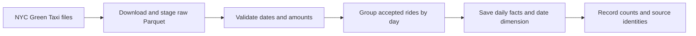

# NYC Taxi Revenue Data Pipeline

[](https://github.com/roy-nfisch/nyc-taxi-revenue-data-pipeline/actions/workflows/ci.yml?query=branch%3Amain)
[](#run-the-checks)
[](#run-locally)
[](#the-flow)
[](#follow-a-run)
[](#run-with-docker-and-prefect)
[](https://github.com/users/roy-nfisch/packages/container/package/nyc-taxi-revenue-data-pipeline)

We built a small, object-oriented Python pipeline that turns NYC Green Taxi
records into daily revenue reports. Our focus was reliable downloads, clear data
rules and a report we can rebuild without doubling the results.

This portfolio project was developed during the neue fische MLE course. The
course supplied the brief and a reference implementation. We built our own
pipeline, validation, tests and Docker/Prefect setup around the public taxi data.

[Run locally](#run-locally) · [Run with Docker](#run-with-docker-and-prefect) · [Technology choices](#technologies-and-why-we-used-them) · [Tests](#run-the-checks)

<p align="center">
  <a href="docs/assets/pipeline-demo.gif"></a>
</p>

*The recording uses a temporary summary script. The supported commands below
print application logs and the metadata path, not the extra presentation table.*

## What we built

- **Checked downloads:** stage the January–March 2025 files, validate them before
  reuse and keep existing files if a refresh fails.
- **Daily reports:** apply the agreed rules, sum recorded charges in exact cents
  and save daily facts, a date dimension and run metadata.
- **Visible runs:** Prefect coordinates the same Python objects, showing task
  states and logs with bounded retries for temporary download failures.
- **Tested delivery:** unit, integration and data checks cover calculations,
  failures and reruns. Docker packages the application and local Prefect server.

The pipeline runs without a notebook or database. Exploration is separate from
the production code. See the [design decisions](docs/adr/001-pipeline-design.md)
for the data rules and object responsibilities.

## Run locally

Use Python 3.13.17 or a newer 3.13 patch and
[uv](https://docs.astral.sh/uv/getting-started/installation/) 0.13.5 or newer.
From a fresh clone:

```bash
git clone https://github.com/roy-nfisch/nyc-taxi-revenue-data-pipeline.git
cd nyc-taxi-revenue-data-pipeline
uv sync --locked
uv run --locked python -m green_taxi --run
```

The first run downloads the public files and needs internet access. Later runs
reuse checked files in `data/raw/` and rebuild the reports in `data/processed/`.
No local configuration file or API key is needed.

Read the result:

```bash
cat data/processed/metadata.json
```

To inspect settings without starting the pipeline, omit `--run`. To download
files without calculating a report, use `uv run --locked python -m green_taxi.download`.

## Run with Docker and Prefect

With Docker and Compose available, use the same checkout:

```bash
docker compose up --build -d --wait prefect
docker compose run --rm flow
```

Check that host port **4205** is free first. Open
[local Prefect](http://127.0.0.1:4205), select a run and inspect its tasks or logs.
No `.env` setup is required.

Docker keeps raw files and reports in a named volume, **not** the host's
`data/` folder. Read the saved metadata from that volume:

```bash
docker compose run --rm --no-deps pipeline python -c \
  "from pathlib import Path; print(Path('/data/processed/metadata.json').read_text())"
```

The plain batch also runs in the image with
`docker compose run --rm --no-deps pipeline`, without Prefect.
Stop the server with `docker compose down`; reports and run history are retained.

### Run the published image

The [public GHCR image](https://github.com/users/roy-nfisch/packages/container/package/nyc-taxi-revenue-data-pipeline)
is available as `2026.11.05` and `latest`. No registry login or local build is needed:

```bash
docker run --rm --platform linux/amd64 \
  --mount type=volume,source=nyc-taxi-release-data,target=/data \
  ghcr.io/roy-nfisch/nyc-taxi-revenue-data-pipeline:2026.11.05
```

This runs the batch, not a public service. Reports persist in the named volume.
The image is Linux amd64; Apple Silicon uses emulation. Native local builds remain
available. See the [verified release and Compose instructions](docs/docker-prefect.md#publish-to-ghcr)
for the digest, result inspection and optional Prefect setup.

### Follow a run

One Prefect flow calls three tasks in order: **download → calculate → save**.
The tasks reuse the existing Python objects; they do not introduce a second
implementation of the data rules.

<p align="center">
  <a href="docs/assets/prefect-pipeline-run.jpg"></a>
</p>

*An actual local run. Bars show timings and arrows show dependencies.
The stages run sequentially; this is not a performance benchmark.*

- Task states and logs show which stage succeeded or failed.
- Downloads get at most three attempts for transient network errors, HTTP 429
  or HTTP 5xx. Invalid data is not retried.
- After saving, the final task logs the period, accepted rides, days and total.

Runs start manually; there is no automatic schedule. Prefect is a local
operations view, not a revenue dashboard or public service.
The [Docker and Prefect guide](docs/docker-prefect.md) covers port changes,
configuration, retries, storage and troubleshooting.

### Change the reporting period

Edit `reporting_period` in [defaults.json](src/green_taxi/defaults.json), keeping
the other settings. For example, `start_month: "2025-03"` with
`duration_months: 3` selects March–May. Duration must be a positive integer;
the source-month list and end date are generated automatically.

Local Python reads the edited file on the next run. To make Docker read it
without rebuilding the image:

```bash
docker compose -f compose.yaml -f compose.config.yaml run --rm flow
```

Without the override, Docker uses the defaults included when the image was
built. The override mounts the existing file read-only: no directory or config
copy is needed. Save your changes, then run the command again.

Edits to the shared defaults appear in Git; retain the agreed January–March
baseline when submitting changes. See the [configuration guide](docs/docker-prefect.md#custom-json-configuration-optional)
for a separate local JSON file.

### Rebuild or refresh

Run the same batch command again to rebuild from checked raw files. Reports are
replaced, not appended. To deliberately refresh downloads in a local Python run:

```bash
uv run --locked python -m green_taxi --run --force
```

Use only one batch per data directory at a time. Docker refresh commands,
including the mounted-config version, are in the [Docker guide](docs/docker-prefect.md).

## Technologies and why we used them

We kept the stack focused on small Python objects and a pipeline someone else
can run:

| Technology | Why we used it here |
|---|---|
| Python, pandas and PyArrow | Read monthly Parquet files, apply the data rules and write daily reports. |
| Requests | Download source files with explicit timeouts and HTTP error handling. |
| Pydantic | Validate the reporting period, source URL and storage settings before processing. |
| Prefect | Show stage states, retries and logs while reusing the plain Python pipeline. |
| Docker and Compose | Package the runtime and keep data and Prefect history in persistent volumes. The container runs as a non-root user. |
| pytest and pytest-xdist | Check individual rules, component integration and reruns using small synthetic files. |
| Ruff | Keep formatting consistent and catch common Python mistakes. |
| uv | Install locked dependencies for local work, containers and CI. |
| GitHub Actions | Run quality, unit, integration and Docker checks on changes. |

## The flow



This is **batch ETL**: Python transforms a fixed set of staged files before
loading the results into output files. Each run finishes; it does not process a
continuous event stream.

`TaxiPipeline` connects `TaxiDownloader`, `DailyRevenueCalculator` and
`ReportWriter`. Downloading, calculation and publication keep separate
responsibilities.

The Python calculator, coordinator and Prefect flow live in `green_taxi.etl`.
Settings, downloading, report contracts and writing stay shared at package level.
The existing commands still run ETL; `green_taxi.flow` delegates to the moved flow.
There is no implemented ELT path yet.
The [ETL and ELT contracts](docs/etl-elt-contract.md) define optional DuckDB setup
and the source registry; loading and SQL transformations are still future work.

## Results and limitations

The January–March 2025 [real-data review](docs/data-review.md) recorded:

| Measure | Result |
|---|---:|
| Input rides | 146,486 |
| Accepted rides | 146,475 |
| Excluded rides | 11, outside the reporting period |
| Daily facts / calendar dates | 90 / 90 |
| Recorded charges | $3,395,290.56 USD |

The report saves `fact_daily_revenue.parquet`, a CSV copy, `dim_date.parquet`
and `metadata.json`. Facts contain one row per accepted pickup day; the date
dimension describes every day in the period. They join through `service_date`.

- Revenue means recorded `total_amount` charges, not profit; cash tips are not
  included. We retain zero and negative amounts rather than assuming they are errors.
- Invalid dates/amounts and out-of-period pickups are excluded and counted.
  Missing payment type alone does not exclude an otherwise usable ride.
- File months and pickup months can differ. These results describe the reviewed
  source files, not a guarantee for future downloads or every ride in the city.
- Checksums identify the input bytes; they do not prove the fares are correct.
  Metadata records the period, source identities, code identity and run counts.
  For reused files, the original download URL is unknown; metadata keeps the
  current configured URL separately rather than attributing cached bytes to it.
- Report publication is not a multi-file transaction. A replacement failure can
  leave mixed files without success metadata; fix the error and rerun. An older
  report left after an early-stage failure is not evidence that the new run succeeded.

See the [data rules and reliability design](docs/adr/001-pipeline-design.md)
for details. This is a local educational pipeline, not a production reporting service.

## Run the checks

From the project root, after installing the development dependencies:

```bash
uv sync --locked
uv run --locked ruff check src tests
uv run --locked ruff format --check src tests
uv run --locked pytest -n 2 --dist loadfile
uv build
```

| Category | What it checks |
|---|---|
| Unit | Settings, logging, date/money rules and calendar generation. |
| Integration | CLI, file I/O, pipeline wiring, Prefect behavior and reruns. |
| Data | An additional label for file structure and output rules, not a separate duplicate CI job. |

CI runs quality checks first, then unit, integration and Docker jobs.
The integration job installs the optional `elt` extra for registry checks; unit
and Docker jobs keep the default ETL installation. Locally, use
`uv run --locked --extra elt pytest -n 2 --dist loadfile` to include those checks.
Without the extra, registry tests skip rather than requiring DuckDB for ETL.
Integration uses two workers grouped by file. Tests use tiny synthetic inputs
and fake HTTP responses, not public downloads. Docker checks are opt-in locally;
the [Docker guide](docs/docker-prefect.md#retries-and-checks) explains how to run them.

## Repository layout

```text
nyc-taxi-revenue-data-pipeline/
├── src/green_taxi/
│   ├── settings.py, defaults.json  # Validated run settings
│   ├── download.py                 # Download and check raw files
│   ├── reporting.py                # Shared result, calendar and money helpers
│   ├── report.py                   # Check and save the report
│   ├── flow.py                     # Delegate for the existing Prefect command
│   ├── __main__.py, logging.py     # Terminal entry point and logs
│   ├── etl/
│   │   ├── revenue.py              # Apply rules and calculate daily totals
│   │   ├── pipeline.py             # Connect the existing stage objects
│   │   └── flow.py                 # Prefect tasks and flow
│   └── elt/sql/schema.sql          # Optional registry DDL; no ELT pipeline yet
├── tests/
│   ├── green_taxi/                 # Shared component tests and fixtures
│   │   ├── etl/                    # Mirrors the Python ETL modules
│   │   └── elt/                    # Optional registry contract checks
│   ├── packaging/                  # Installed wheel, SQL resource and ETL smoke checks
│   └── docker/                     # Image and Compose checks
├── notebooks/                      # Optional data exploration
├── docs/                           # Design, data review and run guide
│   └── assets/                     # Terminal GIF and Prefect screenshot
├── data/                           # Generated locally; ignored by Git
│   ├── raw/                        # Staged source files
│   └── processed/                  # Daily facts, date dimension and metadata
├── .github/workflows/              # Automated checks
├── .github/scripts/                # Release-tag safety check
├── Dockerfile, compose.yaml        # Application and local Prefect runtime
├── compose.config.yaml             # Read-only host JSON override
├── .env.example                    # Optional Compose settings
└── pyproject.toml, uv.lock         # Package and locked dependencies
```

The tree shows the main areas, not every file. Docker's generated data lives in
its named volume rather than the host `data/` directory.

## Challenges and decisions

- **Agree on rules before cleaning.** Negative charges are not automatically bad
  records. We documented the decisions before implementing them.
- **Test the result, not just the exit code.** The data review independently
  reconciles daily counts and amounts, then checks that a rebuild gives the same tables.
- **Keep one implementation.** Plain Python and Prefect share the stage objects;
  orchestration handles execution, not a second set of business rules.
- **Make storage visible.** Host files and container volumes are different.
  Configuration changes need either a read-only mount or an image rebuild.

## Project notes

- [Design decisions](docs/adr/001-pipeline-design.md): scope, data rules and object responsibilities.
- [ELT design](docs/adr/002-elt-comparison.md): a separate database-first comparison, being delivered in small steps.
- [ETL and ELT contracts](docs/etl-elt-contract.md): existing ETL, proposed ELT and shared boundaries.
- [Real-data review](docs/data-review.md): source identities, reconciliation and repeat-run evidence.
- [Exploration notebook](notebooks/01-explore-green-taxi.ipynb): inspect one staged file without changing it.
- [Docker and Prefect](docs/docker-prefect.md): configuration, storage and troubleshooting.
- [Image publishing](docs/docker-prefect.md#publish-to-ghcr): manual release steps and approval gates.

The project uses [NYC TLC Green Taxi records](https://www.nyc.gov/site/tlc/about/tlc-trip-record-data.page).
This project was developed as part of the neue fische Machine Learning Engineering
course and is presented as educational portfolio work.
The original software notice remains in [LICENSE](LICENSE).
