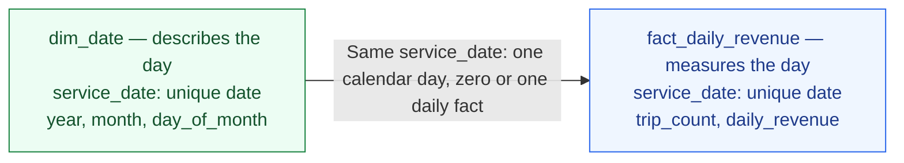

# ADR 001 — A small local taxi pipeline

**Status: Accepted for implementation planning — 04.11.2026.** The owner approved
the data rules and the small fact/date-dimension layout. Docker and Prefect are
required. This accepts the plan, not an implemented or verified pipeline.
Created: 03.11.2026. ADR means **Architecture Decision Record**: what we choose and why.

## Context

We will turn three Green Taxi files (January–March 2025) into a daily revenue
report, running through Prefect in Docker. We want a small, testable portfolio
project, not a platform. The supplied solution is a reference, not our design contract.

## Design

Use local **batch ETL**, pandas, and Parquet. Each run processes a fixed set of
monthly files and finishes; this is not a continuous event stream. Transform staged files in Python, then
write the final report to disk. Raw staging is not the final load destination.
Read and summarise one monthly file at a time, then combine daily summaries.

Following King County's composition approach, each object owns one job:

| Component | Owns | Must not own |
|---|---|---|
| `PipelineSettings` — Pydantic | Validate requested months and configured paths | Download or transform data |
| `TaxiDownloader` | Download and validate complete staged files | Calculate revenue |
| `DailyRevenueCalculator` | Check required columns, apply agreed row rules, aggregate daily facts | HTTP requests or saving reports |
| `ReportWriter` | Save the checked fact/date tables and run counts | Change the calculation |
| `TaxiPipeline` | Connect these components and report success/failure | Repeat their logic |

A thin CLI creates the objects. The required Prefect flow reuses them, with
separate download, calculation, and save tasks. Avoid a generic
repository/factory hierarchy; small helper functions are fine inside these responsibilities.
Pydantic checks settings, not millions of individual ride objects; pandas checks the tables.

Month selection lives in packaged `defaults.json`, not a Python Literal or
duplicated default list. `PipelineSettings.from_file()` loads that file or a
user-supplied JSON object and validates its contents. Direct construction must
supply months explicitly. Calendar-format validation is reusable; the default
selection and the agreed reporting period remain January–March 2025. A different
source selection alone does not approve different reporting-period rules.
The thin Click command prints settings; it does not replace Prefect orchestration.

Design for Docker from the start: configure paths, mount raw/output storage,
and keep container setup outside the calculation objects. Compose will run the
pipeline and local Prefect services; check host ports before starting. Prefect
coordinates execution, while the Python objects own the data rules. Local Python
and container execution must share that logic, not become two implementations.
An alternative orchestrator would need a documented decision before switching.

Target layout (settings/logging and their tests now exist; later stages remain planned):

```text
src/green_taxi/           settings.py, download.py, revenue.py, report.py, pipeline.py, cli.py
tests/green_taxi/         Matching test modules; small fixtures, no live downloads in CI
data/raw/                Original downloaded files — ignored
data/processed/          Generated fact/date tables and run counts — ignored
solution/                Supplied reference; remove before public release
```

## Accepted data rules

| Question | Decision |
|---|---|
| Revenue definition | Sum `total_amount` in USD: recorded charges excluding cash tips, not profit or verified cash collected. No automatic fallback to a partial sum of fare components. |
| Day and period | Use the calendar date in `lpep_pickup_datetime`, without an invented timezone conversion. Keep pickup dates from 01.01.2025 inclusive to 01.04.2025 exclusive; count out-of-period exclusions. |
| Missing or invalid values | Missing required columns stop the run. Exclude rows with invalid dates or missing/non-finite/non-numeric amounts; report counts using non-overlapping exclusion reasons. An entirely invalid input fails rather than reporting success. |
| Zero and negative amounts | Keep finite zero/negative values and report their counts. Do not assume negative values are errors or label them all as refunds. |
| Missing payment type | Keep records with usable pickup dates and amounts; payment type is not needed for this report. |
| Duplicate input | Reject a repeated input file path. Do not remove similar-looking rides without a reliable trip identifier or an agreed duplicate rule. |
| Money precision | Use exact decimal arithmetic and display two decimal places. The inspected amounts are expressible in cents, so no sub-cent rounding is needed. Unexpected extra decimal places stop the run for review rather than silently introducing a rounding rule. |
| Output | Save the fact and date tables below as Parquet, a readable CSV copy of the fact table, and included/excluded run counts. Do not invent zero-revenue facts for missing days. |

## Fact and dimension layout

**Facts measure something; dimensions describe it.** Keep two small tables linked
by `service_date`, using the date itself rather than an unnecessary numeric ID.



| Table / output | What one row represents (the grain) | Columns |
|---|---|---|
| `fact_daily_revenue.parquet` and `.csv` | One pickup day with accepted ride records | `service_date` (date), `trip_count` (integer), `daily_revenue` (decimal USD) |
| `dim_date.parquet` | One calendar day in the reporting period | `service_date` (date), `year`, `month`, `day_of_month` (integers) |

`dim_date` contains all 90 days from 01.01.2025 through 31.03.2025. The fact table
contains only days with accepted records, and `trip_count` includes zero/negative
amount records. Each fact must match exactly one dimension row. Both dates must
be unique and non-null; this daily grain gives at most one fact per date. Joining
the tables must not multiply rows or change totals.

Calendar rows do not imply zero revenue: a missing fact means no accepted records
were available, not that we proved no rides occurred. Generate the calendar with
a small pure helper; no separate service or class hierarchy is needed.

The raw files retain trip-level facts (one row per ride). Do not create another
full `fact_trips` copy. Source files and exclusion counts belong in run metadata,
not extra dimensions. No vendor, location, or payment dimensions are needed for
this daily report. The date dimension demonstrates modelling and supports month
grouping; it is an agreed educational addition, not necessary for the sum itself.

## Inspection evidence — 04.11.2026

Official definitions: [Green Taxi dictionary](https://www.nyc.gov/assets/tlc/downloads/pdf/data_dictionary_trip_records_green.pdf)
and [TLC dataset page](https://www.nyc.gov/site/tlc/about/tlc-trip-record-data.page).
All records were profiled and example rows inspected in temporary files outside
the repository; this did not run our future pipeline.

| Downloaded file | Records | Negative totals | Zero totals | Pickups outside Jan–Mar |
|---|---:|---:|---:|---:|
| `green_tripdata_2025-01.parquet` | 48,326 | 153 | 33 | 6 |
| `green_tripdata_2025-02.parquet` | 46,621 | 165 | 74 | 0 |
| `green_tripdata_2025-03.parquet` | 51,539 | 160 | 147 | 5 |

The files share a schema. No missing pickup dates, missing/non-finite totals,
sub-cent totals, or exact duplicate rows were found; 7,902 payment types were
missing. Filename months do not always match pickup months. Under the accepted
rules, 146,475 of 146,486 records remain, across 90 pickup dates. These are
inspection results for the downloaded files, not pipeline test results or a
guarantee that the source covers every journey. Synthetic failure tests remain necessary.

## Reliability and checks

- Download into a temporary file; check readability and required columns before
  replacing the final staged file. Validate existing files before reusing them.
- Rebuild the report from the selected inputs rather than append on every run.
  Validate outputs before replacing prior files. Do not claim a successful run
  if any output write fails; cross-file atomic publication is not promised.
- Test known totals, period boundaries, invalid values, repeated inputs, and
  aggregation across files. Read saved outputs back in an integration test.
- Reconcile accepted ride counts and amounts with the report. Settings/schema
  validation alone does not prove that the business calculation is correct.
- Check date uniqueness, calendar coverage, fact-to-date references, and an
  unchanged row count and revenue total after joining the two tables.

## Run history and rebuilds

**Lineage means knowing where a result came from.** Save a small JSON metadata
file with each successful run's outputs:

- Run ID, UTC start/finish times, and the reporting period.
- Each input's filename, source URL, byte size, and SHA-256 checksum. A filename
  alone cannot identify the contents if the provider replaces a file.
- Code revision when available; explicitly record `unknown` otherwise. Record
  uncommitted changes when that information is available rather than imply a clean revision.
- Output filenames and the included/excluded counts already required above.

A checksum identifies content; it does not prove the source or values are correct.
This is file-level lineage, not a separate tracking service or per-ride audit system.

Start runs **manually through Prefect in Docker**. Keep the plain Python entry
point for testing and local use. No automatic schedule or new-month ingestion is
planned: repeatedly scheduling the same historical files adds no new data.

Document how to rebuild the selected reporting period from staged inputs and how
to refresh the downloads deliberately. Same input contents, rules, and code must
produce equivalent fact/date tables, not appended duplicates. Run IDs and times
will differ; metadata is not expected to be byte-identical. Changed source files
must be identifiable by changed checksums, not silently presented as the old inputs.
Verify one manual run, one rebuild, and recovery from a simulated transient failure.

## Trade-offs and scope

Local files avoid a database and make the core easy to run. A monthly file must
still fit in memory; this is not a distributed or real-time pipeline. We choose
pandas because it is already supplied; Polars or DuckDB remain alternatives,
not additional engines to maintain. Tests and CI are our additions.

Prefect and Docker are required deliverables, not optional follow-ups. This adds
container lifecycle, persistent storage, and Prefect connection configuration to
verify. A passing run must produce the checked report and visible flow/task states;
retries must not duplicate results. No API, ML model, dbt, broker, dashboard,
cloud deployment, or registry publishing is needed.
Keep the reference unchanged during development and remove its folder before
public release. Retain source attribution and the existing license notice.

## Acceptance record — 04.11.2026

- [x] Inspect real data and source definitions; owner approved revenue and date rules.
- [x] Agree on exclusions, negative values, duplicate handling, and exact money.
- [x] Agree on the simple OOD plan and fact/date outputs; owner approved the layout.
- [x] Require Docker and Prefect and define completion checks. Runtime verification
  belongs to the implementation tasks, not this planning approval.
- [x] Explicitly identify batch processing and agree on lineage metadata and
  manual-run/rebuild behaviour (04.11.2026 follow-up).

Record later decision changes here. Implementation progress belongs in
[TASKS.md](../../TASKS.md). The foundation does not yet run the data pipeline.
