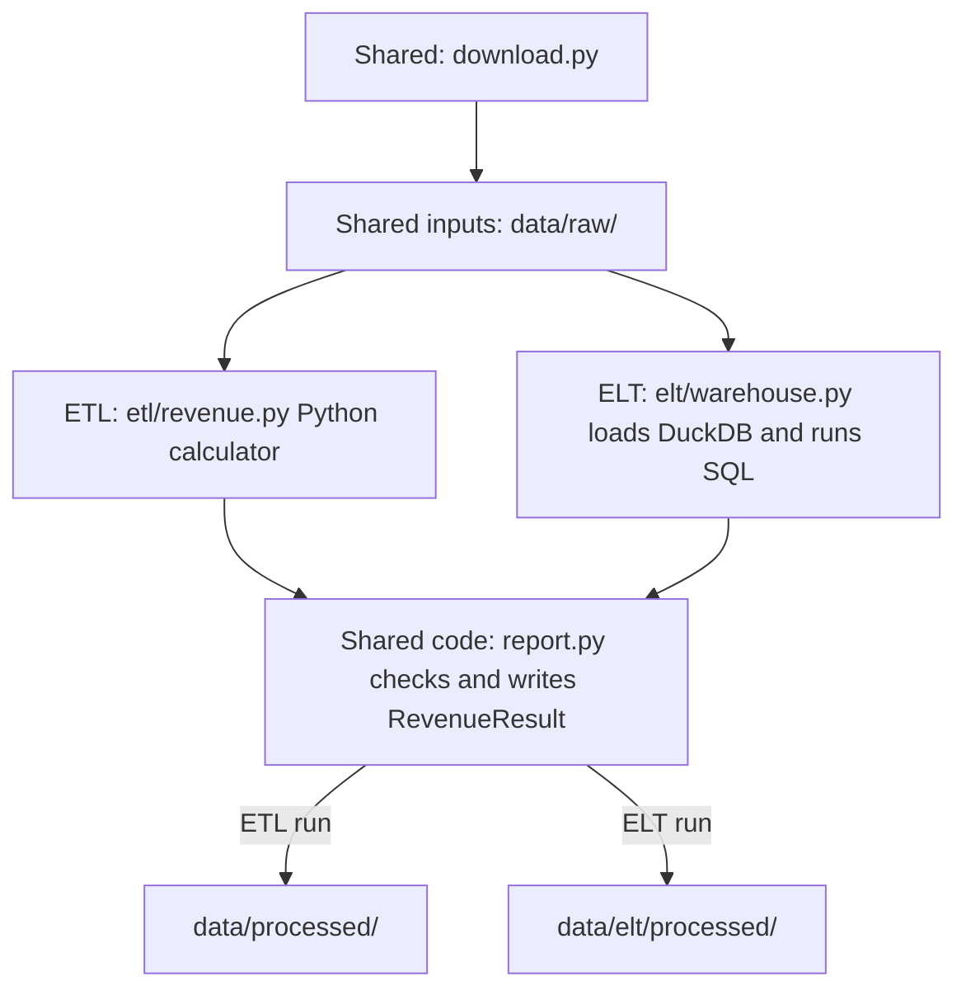

# Compare ETL and ELT

Status: design merged in PR #11; ETL folder separation merged in PR #12.
The optional dependency and source-registry foundation are in progress. Database
loading and SQL business transformations are not implemented yet.

## Why add this

The working ETL pipeline transforms taxi records in Python before writing reports.
We want to learn the alternative: load unchanged records into a database first,
then transform them with SQL. The existing ETL remains the comparison baseline,
not something to remove or silently replace.

This is a learning comparison, not a required upgrade. The useful additions are
SQL transformations, database transactions and evidence that both paths follow
the same rules. We will also document the extra storage and maintenance they add.

## Proposed approach

Use **DuckDB**, stored as one local database file. It keeps this educational
comparison runnable without another server, account or set of credentials.
PostgreSQL would suit a shared service better, but is not needed for this first
comparison. Start with plain SQL; adding dbt is a separate decision, not a
requirement for ELT.

Prefect coordinates download, raw load, transform and save. It does not own the
SQL or copy the data rules. Local Python and Docker use the same objects.

The concrete raw-storage layout, warehouse operation contracts and task ownership
are recorded in the [ETL and ELT contracts](../etl-elt-contract.md). Raw records use
one table per source file, with original Arrow schema metadata stored in the
source registry rather than forcing different files into one common column type.

## Data and reruns

- Keep raw Parquet unchanged. The database raw layer retains the original fields
  and values, with source filename and checksum recorded separately.
  Inspect schema compatibility before loading; never clean or aggregate records
  on the way into the raw layer.
  Preserve type distinctions across files: boolean amounts must not become numbers,
  and timezone-aware pickups must not become naive timestamps. Those invalid rows
  must receive the same exclusions as ETL, not cause a new whole-batch failure.
  If a source cannot be represented without losing these distinctions, stop before
  transformation and document the unsupported schema as a limitation. Automatic
  schema evolution is out of scope. Add a mixed-file fixture with usable rides,
  boolean amounts and timezone-aware pickups to verify this boundary.
- Store a small loaded-file registry. Loading the same bytes again must not append
  duplicate rides. Identity is source-scoped: two different selected source files
  with identical content still contribute both sets of rows, as in ETL.
  If a selected source changes, replace that source's raw rows
  and registry entry together in a database transaction; a failure rolls back both.
  Do not deduplicate rides merely because their business fields look alike. Any
  selected load failure stops the run before transformation or publication.
  No persistent per-ride identity is required. Add a source-scoped row number only
  if inspection needs it; never use it to deduplicate similar-looking rides.
- Build each report from the selected sources and reporting period, not every
  historical row in the database. Records outside the period remain in the raw
  layer but are excluded from the report and counted.
- Preserve the approved date and amount rules, including zero/negative amounts,
  invalid-value accounting, exact cents and rejection of sub-cent amounts.
  A SQL cast must not quietly round money or guess ambiguous date formats.
  Preserve exclusion order: invalid pickup, then outside period, then invalid
  amount. An out-of-period sub-cent amount must not fail an otherwise valid run.
  A batch with no accepted records must still fail. Parity fixtures must include
  these cases, booleans, non-finite money and timezone-aware pickups.
- Produce the same daily fact and date-dimension contracts as ETL. Use the existing
  report writer for Parquet, CSV and metadata. Record execution mode, engine version
  and input identities so a result is traceable.
  Keep ETL and ELT reports in separate output directories so comparison never
  overwrites the baseline. Reusing the writer does not mean sharing its destination.
- Use one writer per database/report directory. This is a local batch comparison,
  not a concurrent ingestion service or production warehouse.

## Keep the objects small

Reuse settings, downloading and checked report publication.
A small warehouse object owns the DuckDB connection, transactional raw loading
and SQL execution. A thin ELT coordinator connects those operations. Keep SQL
in named files, avoid a generic pipeline framework, and do not add inheritance
just to share code. Extract a small shared helper, such as metadata construction,
only when both paths genuinely need it. Do not construct an ETL pipeline merely
to borrow its methods. Agree any necessary extraction from the ETL coordinator
before changing its existing behavior.

## Proposed technologies

DuckDB is the only new runtime dependency and is installed through the optional
`elt` extra; the ordinary ETL installation does not need it. Its version is locked
with the rest of the project dependencies.

| Technology | Existing or proposed? | Job in the ELT comparison |
|---|---|---|
| Python | Existing | Connect small objects and provide the manual entry point. |
| DuckDB | New, optional | Store raw records in a local database, replace source data transactionally and execute SQL. |
| Plain SQL | New transformation files | Classify records, count exclusions and calculate daily revenue inside the database. No dbt initially. |
| pandas and PyArrow | Existing | Keep the current Parquet I/O and report contract; do not move ELT's business transformations back into pandas. |
| Requests and Pydantic | Existing | Reuse checked downloads and validated settings. |
| Prefect | Existing | Coordinate download, raw load, SQL transformation and publication. |
| Docker and Compose | Existing | Run the optional ELT path with its dependency installed, without changing the default ETL command. |
| pytest and pytest-xdist | Existing | Check raw loading, ETL/ELT equivalence, reruns and packaged execution using shared fixtures. |
| uv, setuptools, Ruff and GitHub Actions | Existing | Lock/install dependencies, package SQL resources, check code and run automated verification. |

No PostgreSQL server, dbt project or new orchestration framework is proposed.

## Proposed file tree

This shows the intended full layout. ETL/shared separation is implemented; the
`elt/` package currently contains only the foundation registry SQL and tests.
ELT loading, transformation, orchestration and storage are not built yet.
ETL and ELT become sibling folders inside the same package. Shared components stay outside both;
moving files must not duplicate their implementations or change ETL behaviour.
Only the parts relevant to the comparison are shown.

```text
nyc-taxi-revenue-data-pipeline/
├── src/green_taxi/
│   ├── settings.py, download.py    # Reuse validated settings and checked downloads
│   ├── report.py                 # Shared checked report writer
│   ├── reporting.py              # Shared result, calendar and exact-money helpers
│   ├── logging.py                # Shared application logging
│   ├── __main__.py               # Existing command; still runs ETL by default
│   ├── flow.py                   # Thin delegate for the existing Prefect command
│   ├── etl/                      # Move the existing Python path here
│   │   ├── __init__.py
│   │   ├── revenue.py            # Python calculator and ETL-specific row handling
│   │   ├── pipeline.py           # Existing ETL coordinator
│   │   └── flow.py               # Existing ETL Prefect flow
│   └── elt/                      # New, optional ELT path
│       ├── __init__.py            # No database work or DuckDB import on package import
│       ├── __main__.py            # Thin manual ELT entry point
│       ├── warehouse.py           # Own connection, source registry, raw loads and SQL
│       ├── pipeline.py            # Connect stages and publish a RevenueResult
│       ├── flow.py                # Prefect wrapper around the same ELT objects
│       └── sql/                   # Include in the installed package
│           ├── schema.sql         # Source registry and raw-storage structure
│           ├── classify.sql       # Apply date/amount rules in the agreed order
│           ├── daily_revenue.sql  # Aggregate accepted rides by pickup day
│           └── counts.sql         # Return inclusion/exclusion and amount counters
├── tests/
│   ├── green_taxi/
│   │   ├── conftest.py            # Reuse existing tiny inputs and fake downloads
│   │   ├── test_settings.py       # Shared component tests stay at this level
│   │   ├── test_download.py
│   │   ├── test_report.py
│   │   ├── test_reporting.py      # Shared result, calendar and money-helper checks
│   │   ├── test_parity.py         # Compare ETL and ELT using the same inputs
│   │   ├── etl/                  # Move existing ETL-specific tests; retain coverage
│   │   │   ├── test_revenue.py
│   │   │   ├── test_revenue_files.py
│   │   │   ├── test_pipeline.py
│   │   │   └── test_flow.py       # Includes existing runtime/retry checks
│   │   └── elt/                  # Mirror the new source modules
│   │       ├── test_warehouse.py  # Lossless loading, changed sources and rollback
│   │       ├── test_pipeline.py   # Writer contract and safe ELT reruns
│   │       ├── test_main.py       # Optional command and installed SQL resources
│   │       └── test_flow.py       # Stage order and failure propagation
│   └── docker/
│       └── test_elt.py            # Packaged ELT run; reuse Docker test helpers
├── data/                         # Generated locally; ignored by Git
│   ├── raw/                      # Shared unchanged source files
│   ├── processed/                # Existing ETL reports, unchanged
│   └── elt/
│       ├── warehouse.duckdb      # Raw records and loaded-source registry
│       └── processed/            # Separate ELT facts, dates and metadata
├── pyproject.toml, uv.lock       # Optional dependency and SQL package data
├── Dockerfile, compose.yaml      # Optional ELT support; preserve ETL defaults
└── docs/adr/002-elt-comparison.md # This decision and acceptance checks
```

## How the ETL and ELT files connect

The `etl/` and `elt/` folders are two paths in one project, not copies of the
shared components. Both paths share the inputs and output contract; the
transformation engine changes.
Paths below are relative to `src/green_taxi/`.

| Original file | Location after separation | Connection between ETL and ELT |
|---|---|---|
| `settings.py` | Unchanged | Shared reporting period and settings validation. |
| `download.py` | Unchanged | Shared downloader and unchanged staged Parquet files. |
| `revenue.py` | `etl/revenue.py` and shared `reporting.py` | The Python calculator stays ETL-only. Move the result contract, calendar and helpers needed by the writer into the shared module. |
| `report.py` | Unchanged | Shared output checks and report writing, with separate destinations. |
| `pipeline.py` | `etl/pipeline.py` | Coordinates ETL; the separate `elt/pipeline.py` coordinates ELT. |
| `flow.py` | `etl/flow.py`, with a thin root delegate | Wraps ETL; the separate `elt/flow.py` wraps ELT. Keep `python -m green_taxi.flow` working for existing Compose commands. |
| `__main__.py` | Unchanged | Keeps the existing command and ETL default; it delegates to the moved ETL coordinator. |



These are alternative runs, not parallel branches of one run. Each coordinator
uses the shared writer code with its own output destination. Separate
coordinators keep the extra database-loading stage explicit instead of adding
ETL/ELT conditionals throughout the existing pipeline.

The warehouse returns `RevenueResult` without recalculating revenue in Python.
SQL files do not need matching Python classes or a separate SQL framework.
Keep all existing ETL coverage while moving its tests to mirror `etl/`. Shared
component tests remain at package level. New tests mirror `elt/`, reuse existing
fixtures, and use `test_parity.py` for comparisons rather than copy the ETL suite.
Exact file boundaries can change if implementation demonstrates a simpler structure.

## Implementation steps after approval

The checklist, dependencies, file ownership and PR boundaries live in
[T11.1–T11.7](../../TASKS.md#t11-delivery-plan), not a second checklist here.

First move the ETL modules/tests in a behaviour-preserving PR, keeping existing
commands and outputs working. Then agree the raw representation and warehouse
interfaces, optional dependency and SQL packaging in a foundation PR.
Only after that merges can raw loading, transformation SQL and Docker preparation
run in parallel on separate branches. A final integration PR connects the objects
and verifies both paths before any image publication.

SQL results must satisfy the shared writer's types: finite Decimal money, Python
integer counters and the same date-dimension contract. Acceptance includes an
installed-package and container ELT run with the optional dependency and packaged
SQL, plus ordinary ETL without DuckDB; checkout-only execution is insufficient.
Compare both paths using the same real source bytes and repeat the runs.

Publish only after explicit approval and merged verification. Use a clearly
identified ELT image variant/package; preserve the existing ETL image and its
default behaviour. Image publication does not deploy a public service.

Acceptance is equivalent checked output and safe reruns, not just a successful
SQL query. The original reviewed files give 146,475 accepted rides, 90 daily
facts and USD 3,395,290.56; changed files require fresh reconciliation.

## Decisions for this PR

- [ ] Approve DuckDB rather than PostgreSQL for the first comparison.
- [ ] Approve plain SQL rather than adding dbt now.
- [ ] Approve a separate optional ELT path while retaining ETL as the default.

The first delivery step only reorganises ETL/shared code and tests. Database
dependencies, SQL transformations, ELT images and data storage remain later tasks.
