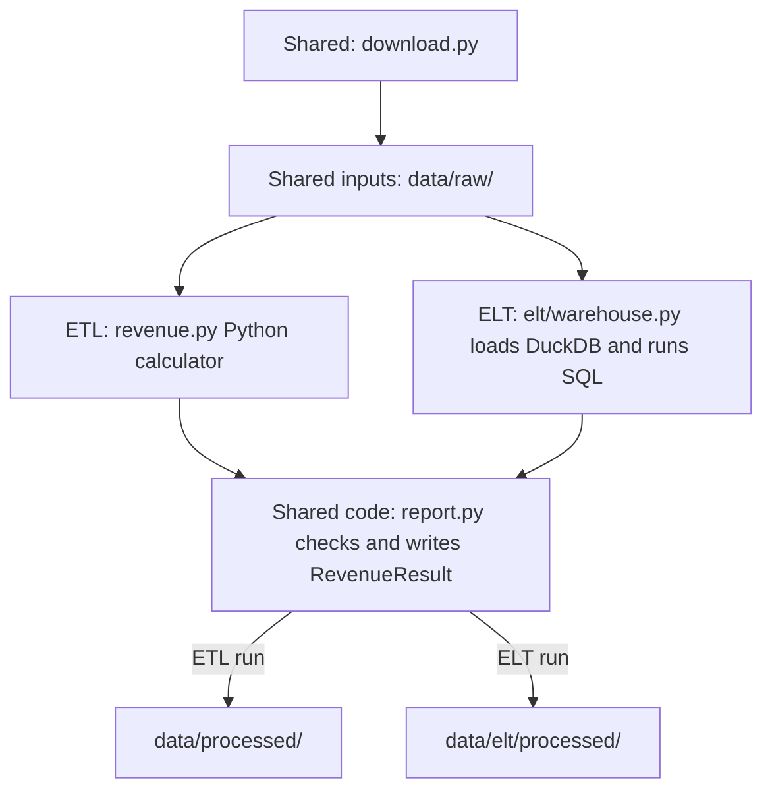

# Compare ETL and ELT

Status: proposed for owner review. No ELT implementation is included yet.

## Why add this

The working ETL pipeline transforms taxi records in Python before writing reports.
We want to learn the alternative: load unchanged records into a database first,
then transform them with SQL. The existing ETL remains the comparison baseline,
not something to remove or silently replace.

This is a learning comparison, not a required upgrade. The useful additions are
SQL transformations, database transactions and evidence that both paths follow
the same rules. We will also document the extra storage and maintenance they add.

## Proposed approach

Use **DuckDB**, stored as one local database file. It keeps this educational
comparison runnable without another server, account or set of credentials.
PostgreSQL would suit a shared service better, but is not needed for this first
comparison. Start with plain SQL; adding dbt is a separate decision, not a
requirement for ELT.

Prefect coordinates download, raw load, transform and save. It does not own the
SQL or copy the data rules. Local Python and Docker use the same objects.

## Data and reruns

- Keep raw Parquet unchanged. The database raw layer retains the original fields
  and values, with source filename and checksum recorded separately.
  Inspect schema compatibility before loading; never clean or aggregate records
  on the way into the raw layer.
  Preserve type distinctions across files: boolean amounts must not become numbers,
  and timezone-aware pickups must not become naive timestamps. Those invalid rows
  must receive the same exclusions as ETL, not cause a new whole-batch failure.
  If a source cannot be represented without losing these distinctions, stop before
  transformation and document the unsupported schema as a limitation. Automatic
  schema evolution is out of scope. Add a mixed-file fixture with usable rides,
  boolean amounts and timezone-aware pickups to verify this boundary.
- Store a small loaded-file registry. Loading the same bytes again must not append
  duplicate rides. Identity is source-scoped: two different selected source files
  with identical content still contribute both sets of rows, as in ETL.
  If a selected source changes, replace that source's raw rows
  and registry entry together in a database transaction; a failure rolls back both.
  Do not deduplicate rides merely because their business fields look alike. Any
  selected load failure stops the run before transformation or publication.
  No persistent per-ride identity is required. Add a source-scoped row number only
  if inspection needs it; never use it to deduplicate similar-looking rides.
- Build each report from the selected sources and reporting period, not every
  historical row in the database. Records outside the period remain in the raw
  layer but are excluded from the report and counted.
- Preserve the approved date and amount rules, including zero/negative amounts,
  invalid-value accounting, exact cents and rejection of sub-cent amounts.
  A SQL cast must not quietly round money or guess ambiguous date formats.
  Preserve exclusion order: invalid pickup, then outside period, then invalid
  amount. An out-of-period sub-cent amount must not fail an otherwise valid run.
  A batch with no accepted records must still fail. Parity fixtures must include
  these cases, booleans, non-finite money and timezone-aware pickups.
- Produce the same daily fact and date-dimension contracts as ETL. Use the existing
  report writer for Parquet, CSV and metadata. Record execution mode, engine version
  and input identities so a result is traceable.
  Keep ETL and ELT reports in separate output directories so comparison never
  overwrites the baseline. Reusing the writer does not mean sharing its destination.
- Use one writer per database/report directory. This is a local batch comparison,
  not a concurrent ingestion service or production warehouse.

## Keep the objects small

Reuse settings, downloading and checked report publication.
A small warehouse object owns the DuckDB connection, transactional raw loading
and SQL execution. A thin ELT coordinator connects those operations. Keep SQL
in named files, avoid a generic pipeline framework, and do not add inheritance
just to share code. Extract a small shared helper, such as metadata construction,
only when both paths genuinely need it. Do not construct an ETL pipeline merely
to borrow its methods. Agree any necessary extraction from the ETL coordinator
before changing its existing behavior.

## Proposed technologies

Only DuckDB is a proposed new runtime dependency. Keep it in an optional `elt`
extra; the ordinary ETL installation must not need it. Select and lock a compatible
version during implementation, not by inventing a version in this proposal.

| Technology | Existing or proposed? | Job in the ELT comparison |
|---|---|---|
| Python | Existing | Connect small objects and provide the manual entry point. |
| DuckDB | New, optional | Store raw records in a local database, replace source data transactionally and execute SQL. |
| Plain SQL | New transformation files | Classify records, count exclusions and calculate daily revenue inside the database. No dbt initially. |
| pandas and PyArrow | Existing | Keep the current Parquet I/O and report contract; do not move ELT's business transformations back into pandas. |
| Requests and Pydantic | Existing | Reuse checked downloads and validated settings. |
| Prefect | Existing | Coordinate download, raw load, SQL transformation and publication. |
| Docker and Compose | Existing | Run the optional ELT path with its dependency installed, without changing the default ETL command. |
| pytest and pytest-xdist | Existing | Check raw loading, ETL/ELT equivalence, reruns and packaged execution using shared fixtures. |
| uv, setuptools, Ruff and GitHub Actions | Existing | Lock/install dependencies, package SQL resources, check code and run automated verification. |

No PostgreSQL server, dbt project or new orchestration framework is proposed.

## Proposed file tree

This is the intended layout, not files already implemented. Show only the parts
relevant to the comparison; existing ETL modules and tests remain in place.

```text
nyc-taxi-revenue-data-pipeline/
├── src/green_taxi/
│   ├── settings.py, download.py    # Reuse validated settings and checked downloads
│   ├── report.py, revenue.py      # Reuse writer, result contract and calendar helper
│   ├── pipeline.py, flow.py       # Existing ETL remains the default
│   └── elt/                      # New, optional ELT path
│       ├── __init__.py            # No database work or DuckDB import on package import
│       ├── __main__.py            # Thin manual ELT entry point
│       ├── warehouse.py           # Own connection, source registry, raw loads and SQL
│       ├── pipeline.py            # Connect stages and publish a RevenueResult
│       ├── flow.py                # Prefect wrapper around the same ELT objects
│       └── sql/                   # Include in the installed package
│           ├── schema.sql         # Source registry and raw-storage structure
│           ├── classify.sql       # Apply date/amount rules in the agreed order
│           ├── daily_revenue.sql  # Aggregate accepted rides by pickup day
│           └── counts.sql         # Return inclusion/exclusion and amount counters
├── tests/
│   ├── green_taxi/
│   │   ├── conftest.py            # Reuse existing tiny inputs and fake downloads
│   │   └── elt/                  # Mirror the new source modules
│   │       ├── test_warehouse.py  # Lossless loading, changed sources and rollback
│   │       ├── test_pipeline.py   # ETL parity, writer contract and safe reruns
│   │       ├── test_main.py       # Optional command and installed SQL resources
│   │       └── test_flow.py       # Stage order and failure propagation
│   └── docker/
│       └── test_elt.py            # Packaged ELT run; reuse Docker test helpers
├── data/                         # Generated locally; ignored by Git
│   ├── raw/                      # Shared unchanged source files
│   ├── processed/                # Existing ETL reports, unchanged
│   └── elt/
│       ├── warehouse.duckdb      # Raw records and loaded-source registry
│       └── processed/            # Separate ELT facts, dates and metadata
├── pyproject.toml, uv.lock       # Optional dependency and SQL package data
├── Dockerfile, compose.yaml      # Optional ELT support; preserve ETL defaults
└── docs/adr/002-elt-comparison.md # This decision and acceptance checks
```

## How the ETL and ELT files connect

The `elt/` folder extends the existing package; it is not a second project.
Both paths share the inputs and output contract. The transformation engine changes.
Paths below are relative to `src/green_taxi/`.

| Existing file | Connection to the proposed ELT path |
|---|---|
| `settings.py` | Reuse the reporting period and settings validation. |
| `download.py` | Reuse the downloader and unchanged staged Parquet files. |
| `revenue.py` | ETL keeps its Python calculator. ELT reuses `RevenueResult` and the calendar helper, not the calculator. |
| `report.py` | Reuse output checks and report writing, with separate destinations. |
| `pipeline.py` | Keeps coordinating ETL. New `elt/pipeline.py` coordinates database loading, SQL transformation and publication. |
| `flow.py` | Keeps the ETL Prefect flow. New `elt/flow.py` coordinates the ELT objects. |



These are alternative runs, not parallel branches of one run. Each coordinator
uses the shared writer code with its own output destination. Separate
coordinators keep the extra database-loading stage explicit instead of adding
ETL/ELT conditionals throughout the existing pipeline.

The warehouse returns `RevenueResult` without recalculating revenue in Python.
SQL files do not need matching Python classes or a separate SQL framework.
Existing ETL tests remain; new tests mirror `elt/`, reuse existing fixtures and
compare the two paths' reports rather than copy the whole ETL test suite.
Exact file boundaries can change if implementation demonstrates a simpler structure.

## Implementation steps after approval

1. Add DuckDB as an explicit optional dependency; keep ETL runnable without it.
2. Implement transactional raw loading and source identity tracking with tiny
   fixtures, including unchanged, changed and failed loads.
3. Implement SQL transformation and output conversion. Compare every date,
   ride count, exact amount, exclusion count and date reference with ETL.
   Return the existing writer's expected types, including finite Decimal money,
   Python integer counters and the same date-dimension contract.
4. Add a separate manual Python/Prefect entry point and Docker instructions.
   Keep the current default command and published ETL image behavior unchanged.
   Verify ELT from an installed package and a built container, with the optional
   DuckDB dependency and named SQL files included. Also verify ordinary ETL
   without that optional dependency; a checkout-only run is not sufficient.
5. Run both paths on the same real January–March source bytes, repeat them, and
   document equal results plus the extra storage and complexity ELT introduces.

Acceptance is equivalent checked output and safe reruns, not just a successful
SQL query. The original reviewed files give 146,475 accepted rides, 90 daily
facts and USD 3,395,290.56; changed files require fresh reconciliation.

## Decisions for this PR

- [ ] Approve DuckDB rather than PostgreSQL for the first comparison.
- [ ] Approve plain SQL rather than adding dbt now.
- [ ] Approve a separate optional ELT path while retaining ETL as the default.

This proposal does not change the application, dependencies, image or data.
