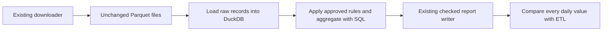

# Compare ETL and ELT

Status: proposed for owner review. No ELT implementation is included yet.

## Why add this

The working ETL pipeline transforms taxi records in Python before writing reports.
We want to learn the alternative: load unchanged records into a database first,
then transform them with SQL. The existing ETL remains the comparison baseline,
not something to remove or silently replace.

## Proposed approach

Use **DuckDB**, stored as one local database file. It keeps this educational
comparison runnable without another server, account or set of credentials.
PostgreSQL would suit a shared service better, but is not needed for this first
comparison. Start with plain SQL; adding dbt is a separate decision, not a
requirement for ELT.

Prefect coordinates download, raw load, transform and save. It does not own the
SQL or copy the data rules. Local Python and Docker use the same objects.

## Data and reruns

- Keep raw Parquet unchanged. The database raw layer retains the original fields
  and values, with source filename, checksum and row identity recorded separately.
  Inspect schema compatibility before loading; never clean or aggregate records
  on the way into the raw layer.
- Store a small loaded-file registry. Loading the same bytes again must not append
  duplicate rides. Identity is source-scoped: two different selected source files
  with identical content still contribute both sets of rows, as in ETL.
  If a selected source changes, replace that source's raw rows
  and registry entry together in a database transaction; a failure rolls back both.
  Do not deduplicate rides merely because their business fields look alike. Any
  selected load failure stops the run before transformation or publication.
- Build each report from the selected sources and reporting period, not every
  historical row in the database. Records outside the period remain in the raw
  layer but are excluded from the report and counted.
- Preserve the approved date and amount rules, including zero/negative amounts,
  invalid-value accounting, exact cents and rejection of sub-cent amounts.
  A SQL cast must not quietly round money or guess ambiguous date formats.
  Preserve exclusion order: invalid pickup, then outside period, then invalid
  amount. An out-of-period sub-cent amount must not fail an otherwise valid run.
  A batch with no accepted records must still fail. Parity fixtures must include
  these cases, booleans, non-finite money and timezone-aware pickups.
- Produce the same daily fact and date-dimension contracts as ETL. Use the existing
  report writer for Parquet, CSV and metadata. Record execution mode, engine version
  and input identities so a result is traceable.
  Keep ETL and ELT reports in separate output directories so comparison never
  overwrites the baseline. Reusing the writer does not mean sharing its destination.
- Use one writer per database/report directory. This is a local batch comparison,
  not a concurrent ingestion service or production warehouse.

## Keep the objects small

Reuse settings, downloading, lineage helpers and checked report publication.
A small warehouse object owns the DuckDB connection, transactional raw loading
and SQL execution. A thin ELT coordinator connects those operations. Keep SQL
in named files, avoid a generic pipeline framework, and do not add inheritance
just to share code. Agree any necessary extraction from the ETL coordinator
before changing its existing behavior.

## Implementation steps after approval

1. Add DuckDB as an explicit optional dependency; keep ETL runnable without it.
2. Implement transactional raw loading and source identity tracking with tiny
   fixtures, including unchanged, changed and failed loads.
3. Implement SQL transformation and output conversion. Compare every date,
   ride count, exact amount, exclusion count and date reference with ETL.
4. Add a separate manual Python/Prefect entry point and Docker instructions.
   Keep the current default command and published ETL image behavior unchanged.
5. Run both paths on the same real January–March source bytes, repeat them, and
   document equal results plus the extra storage and complexity ELT introduces.

Acceptance is equivalent checked output and safe reruns, not just a successful
SQL query. The original reviewed files give 146,475 accepted rides, 90 daily
facts and USD 3,395,290.56; changed files require fresh reconciliation.

## Decisions for this PR

- [ ] Approve DuckDB rather than PostgreSQL for the first comparison.
- [ ] Approve plain SQL rather than adding dbt now.
- [ ] Approve a separate optional ELT path while retaining ETL as the default.

This proposal does not change the application, dependencies, image or data.
