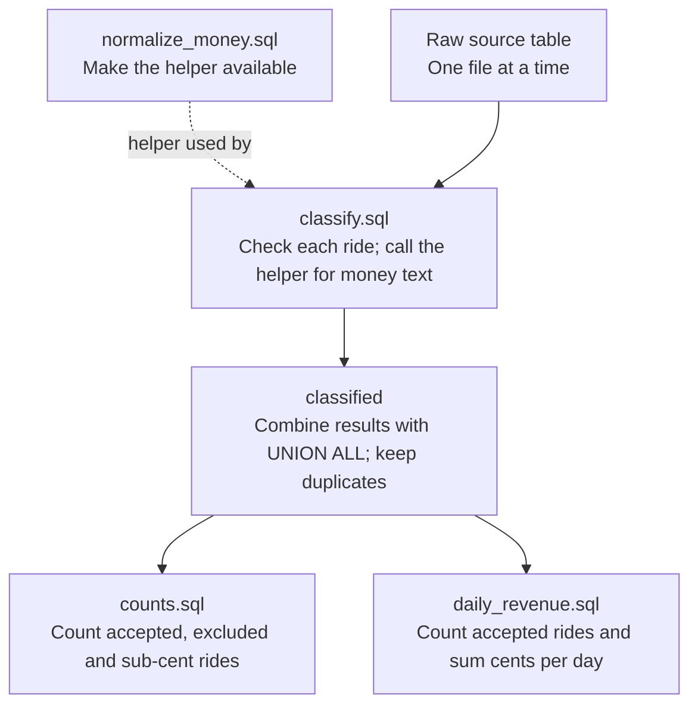

# ELT SQL transformations

These packaged queries classify rides and calculate daily revenue in DuckDB.
The [ELT pipeline](elt-runtime.md) connects these queries. The [ETL and ELT contracts](etl-elt-contract.md)
define the source types and shared report format.

## SQL files

| File | What it does |
|---|---|
| `normalize_money.sql` | Registers a connection-local helper for whitespace, underscores and Unicode digits. |
| `classify.sql` | Gives each ride a date, status and exact integer-cent amount. |
| `daily_revenue.sql` | Counts accepted rides and sums their cents by day. |
| `counts.sql` | Counts accepted, excluded and sub-cent records. |

Normalization is separate to keep classification readable. Its character map
preserves Python 3.13's Unicode digit rules; it does not repair invalid money.

## SQL flow

Python must load and run these SQL files; they do not run one another automatically.
The diagram shows their inputs and dependencies, not an automatic execution order.

The dotted arrow supplies a helper, not ride data. Both final queries read the
same combined results. Neither calls the other, and branching does not mean
they automatically run in parallel.

## How to execute them

The application runs these steps in order:

1. **Set up the helper.** Execute `normalize_money.sql` once per DuckDB connection.
   It registers a temporary function; it does not process rides or save data.
2. **Classify each source.** Run `classify.sql` for one raw table at a time.
   Save each query's result in a temporary table before continuing.
3. **Combine the results.** Use `UNION ALL` to create a table or view named
   `classified`. This keeps duplicates and combines checked rows, not raw columns
   with different types.
4. **Check the counts.** Run `counts.sql`. Stop if `sub_cent > 0` (fractions of a
   cent were found) or `rows_used = 0` (no accepted rides).
5. **Calculate daily totals.** Run `daily_revenue.sql` against `classified`.
   It returns `service_date`, `trip_count` and `revenue_cents`. Convert DuckDB's
   integer-cent strings without using floats, then pass the results to reporting.

Read the files through `importlib.resources.files("green_taxi.elt").joinpath("sql/<name>.sql")`,
so execution does not depend on the terminal's directory.

For classification, replace `__SOURCE_TABLE__` only with a validated, quoted
name such as `"raw"."source_2025_01"`. Allow only
`source_[0-9]{4}_(0[1-9]|1[0-2])`; never insert arbitrary filenames or SQL.
Pass `period_start`, `period_end`, `pickup_kind` and `amount_kind` as bound values,
not SQL text. The start date is included; the end date is excluded. Get the kinds
from the original Arrow schema without converting its types.

## Rules and limits

- Check pickup, then reporting period, then money. Excluded pickups bypass money parsing.
- Dates follow Python's supported ISO forms. Do not guess local formats or epochs,
  or convert timezone-aware pickups to naive dates.
- Money follows `Decimal(str(value))`, including scientific notation.
  Preserve negative and zero charges; reject sub-cents rather than rounding.
- The Unicode mapping follows Python 3.13 / Unicode 15.1. Review it if Python changes.
- More than **100,000 integer-cent digits** raises a resource-limit error.
  This is a failed run, not an excluded record. Exponential zero remains zero.

## ETL comparison

The existing ETL Parquet conversion can round large nullable integers and make
Float32 handling depend on pandas metadata. SQL deliberately preserves the
original values: nullable `9007199254740993` must stay exact, and Float32 `0.1`
must not hide sub-cents.

A separate ETL representation fix addresses these differences. Full parity needs
comparison against that corrected baseline. Tests cover the shared rules,
boundaries, counters, duplicates and actual Parquet representations.
