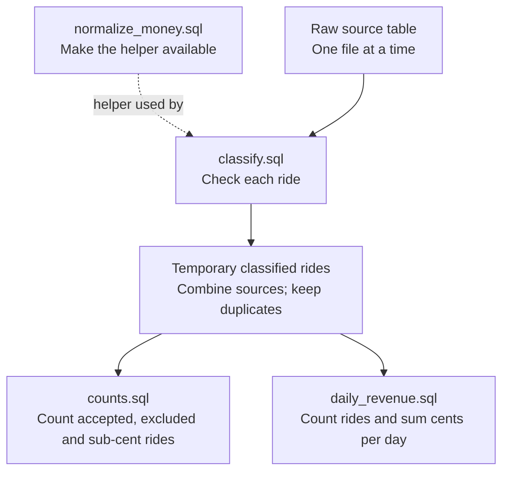

# Run and understand ELT

ETL transforms taxi records in Python before saving reports. ELT first loads
the raw records into DuckDB, then transforms them with SQL. Both use the same
downloads, data rules and report writer. Python connects the stages, DuckDB runs
the SQL, and Prefect shows the stages and their status.

## Run a batch

From the repository root:

```bash
uv sync --locked --extra elt
uv run --locked --extra elt python -m green_taxi.elt
```

The first run downloads the configured months. Later runs verify and reuse them.
Use `--config path/to/run.json` for settings, `--data-dir path` for storage,
or `--force` to deliberately refresh downloads.

### With Docker

```bash
docker compose -f compose.yaml -f compose.elt.yaml build elt-tools
docker compose -f compose.yaml -f compose.elt.yaml run --rm --no-deps elt
```

To see four sequential tasks in Prefect—download, load, transform, save—use
`elt-flow` **instead of** `elt`:

```bash
docker compose up --build -d --wait prefect
docker compose -f compose.yaml -f compose.elt.yaml run --rm elt-flow
```

Check that port 4205 is free, then open [local Prefect](http://127.0.0.1:4205).
No schedule is created. Stop the server with `docker compose down`; data is retained.

## What happens to the data?

| Location | Contents |
|---|---|
| `data/raw/` | Unchanged Parquet inputs, shared with ETL |
| `data/elt/warehouse.duckdb` | Raw tables and a registry of loaded file versions |
| `data/elt/processed/` | ELT daily facts, date dimension and metadata |
| `data/processed/` | Existing ETL reports, left untouched |

Docker uses these paths under `/data` in a named volume, not the host folder.
Metadata records inputs, run identity, execution mode and engine version.

For example, two accepted rides on the same day worth $1.25 and $2.75 produce
one daily fact: **2 rides, $4.00**. Loading the same files and running again
replaces that report—it does not become 4 rides or $8.00.

## SQL flow

Python runs these queries; they do not call one another automatically.



The dotted arrow supplies a text helper, not ride data. Both final queries read
the same classifications; the branches do not mean automatic parallel execution.

1. Register the money-text helper once per connection.
2. Classify each selected source and append its results to temporary run storage.
3. Check counts. Stop for sub-cent money or no accepted rides.
4. Calculate daily totals in SQL and pass exact results to the shared writer.

## Rules and limits

- Raw loading preserves the original records and types. SQL checks the rides later.
- Check pickup date, reporting period, then amount. Preserve zero and negative
  charges. Never guess dates, remove timezone information or round sub-cents.
- Only selected file versions contribute. Changed files replace their own raw
  data safely; failed loads stop the run before reporting. Unsupported types fail
  instead of being silently converted. Use one writer per storage directory.
- Loading verifies one file in memory. The database adds storage and maintenance;
  it is not automatically better than a small Python batch.
- Failed runs do not publish new success metadata. Existing reports belong to
  their earlier run. Multi-file publication is not one atomic transaction.

See [the ADR](adr/002-elt-comparison.md) for object responsibilities, supported
types, SQL interfaces and resource limits.

## Check it

```bash
uv run --locked --extra elt pytest tests/green_taxi/elt/ tests/packaging/ -q
```

After building both images with the default local names, enable isolated Docker
checks with `GREEN_TAXI_DOCKER_TESTS=1 uv run --locked pytest tests/docker/ -q`.
Tests use tiny local data. Real-data verification matched every daily fact,
calendar row and counter with ETL; reruns kept the reviewed $3,395,290.56 total unchanged.
